# Beam Data Flows

This document describes the runtime data flows of Samply.Beam in the order they occur: broker and proxy initialization, task and result exchange (including SSE streaming), socket usage, background maintenance, and health monitoring.

## Table of Contents

- [1. Initialization](#1-initialization)
  - [Broker Initialization](#broker-initialization)
  - [Proxy Startup](#proxy-startup)
  - [Certificate Retrieval](#certificate-retrieval)
- [2. Task and Result Exchange](#2-task-and-result-exchange)
  - [Task Creation](#task-creation)
  - [Task Retrieval](#task-retrieval)
  - [Task Retrieval by ID](#task-retrieval-by-id)
  - [Result Creation](#result-creation)
  - [Result Retrieval (Long-Polling)](#result-retrieval-long-polling)
  - [Result Retrieval (SSE Streaming)](#result-retrieval-sse-streaming)
- [3. Socket Usage](#3-socket-usage)
  - [Socket Creation (Initiator Side)](#socket-creation-initiator-side)
  - [Socket Retrieval (Receiver Side)](#socket-retrieval-receiver-side)
- [4. Background Processes](#4-background-processes)
  - [Task and Result Expiry](#task-and-result-expiry)
- [5. Health Monitoring](#5-health-monitoring)
  - [Health Check Endpoints](#health-check-endpoints)

---

## 1. Initialization

### Broker Initialization

The broker serves requests as soon as it binds its port, and reports itself unhealthy until it fetches the CA chain from Vault. Certificate cache warm-up and Vault retries run concurrently with request handling.

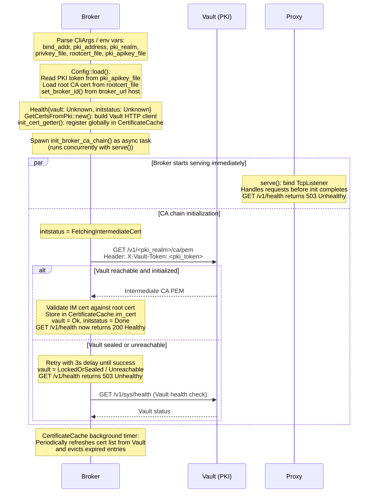

### Proxy Startup

The proxy checks broker health before it attempts any PKI work. All PKI steps share the same exponential-backoff retry logic. After the proxy validates the certificate chain, it starts the HTTP server and opens the long-lived control channel to the broker.

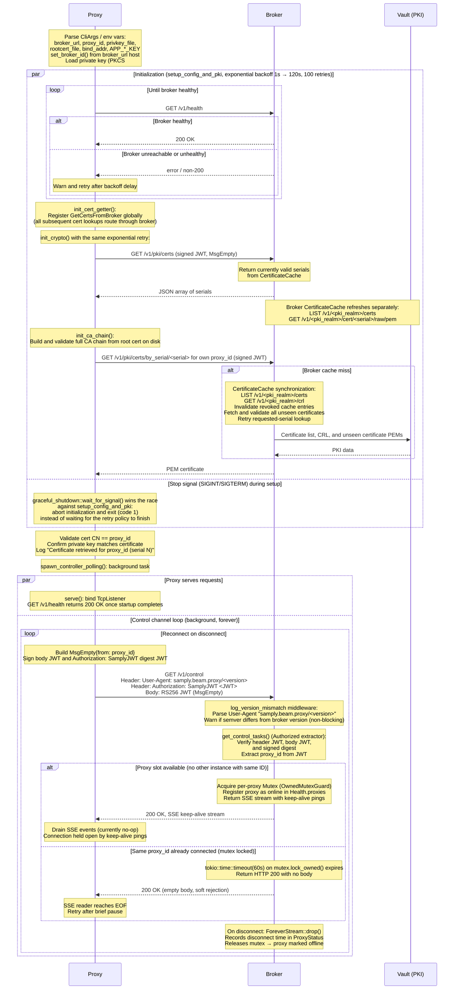

### Certificate Retrieval

Proxy startup (CA chain bootstrap, own-cert validation) and every task/result/socket encryption step fetch recipient public keys through these endpoints. All three PKI endpoints share the same JWT-authenticated broker pattern. The broker answers from its `CertificateCache`. A serial cache miss triggers a full cache synchronization before the broker retries the lookup: list serials, fetch the CRL, invalidate revoked entries, fetch and validate every unseen certificate.

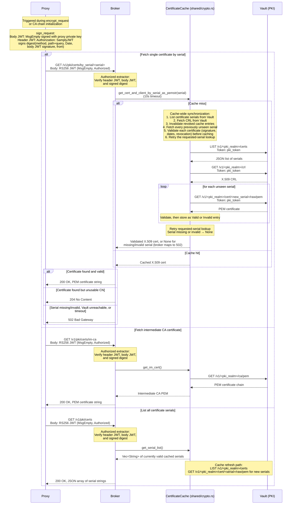

---

## 2. Task and Result Exchange

Proxies end-to-end encrypt all message bodies: the broker stores and forwards ciphertext only. Every proxy-to-broker request carries a signed body JWT and an `Authorization: SamplyJWT` header JWT. The header JWT signs a digest of the HTTP method, path+query, `Date` header, body-JWT signature, and sender; the broker verifies both JWTs against the signer certificate from `CertificateCache` (which may refresh from Vault) and checks that the certificate CN may sign the message `from`.

### Task Creation

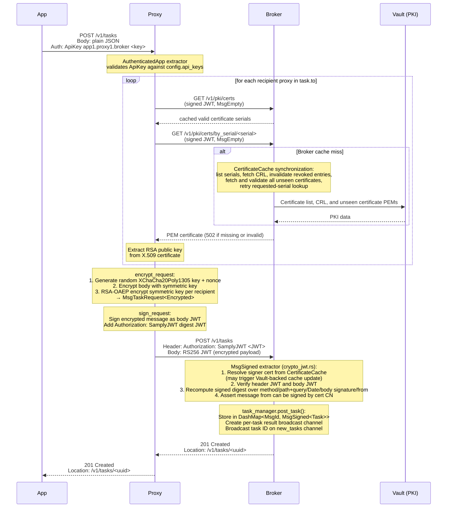

### Task Retrieval

A caller lists tasks with `GET /v1/tasks` and picks one of three filters: `filter=todo` (unanswered work addressed to the caller), `from=<id>` (tasks the caller created), and `to=<id>` (tasks addressed to the caller). A caller may only list tasks it created or tasks addressed to it.

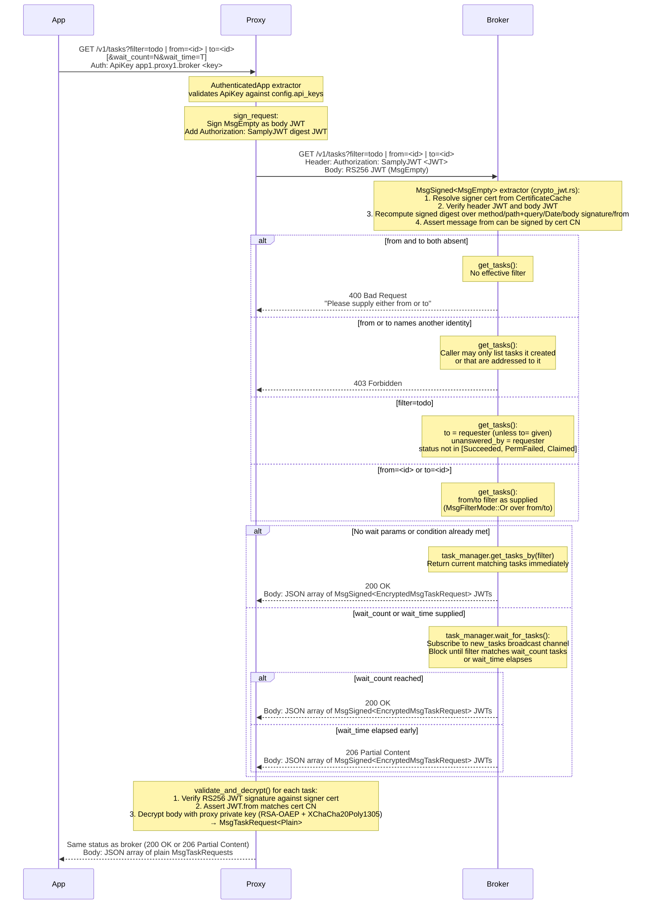

### Task Retrieval by ID

A caller that knows a task's ID fetches that single task with `GET /v1/tasks/<task_id>`. Long polling is optional; `wait_count` must be unset or `1`. The broker authorizes the task creator or any listed recipient and returns `404` for a task that is missing, expired, or invisible to the caller.

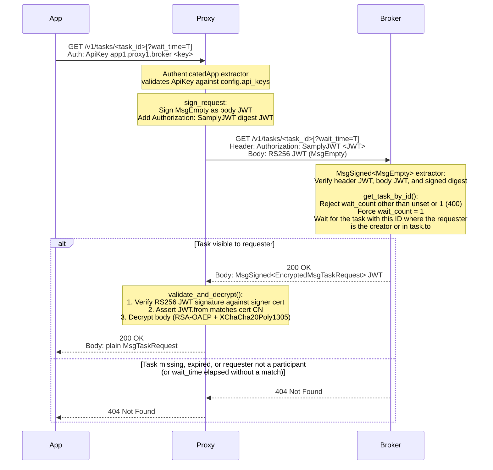

### Result Creation

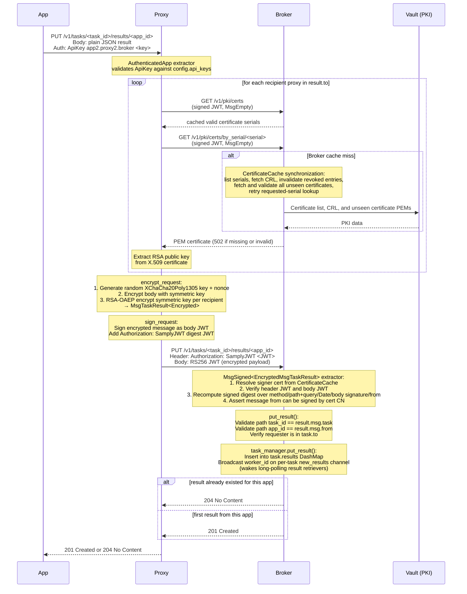

### Result Retrieval (Long-Polling)

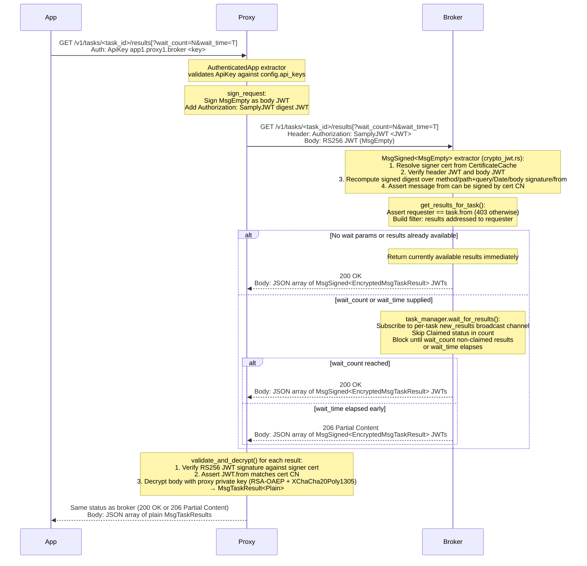

### Result Retrieval (SSE Streaming)

Adding `Accept: text/event-stream` switches from a single blocking response to an open SSE stream. The broker pushes filtered results as `new_result` events; it still streams `Claimed` results but does not count them toward `wait_count`. The proxy decrypts `new_result` payloads inline before forwarding to the app. The stream carries control events (`wait_expired`, `deleted_task`, `error`) that need no decryption.

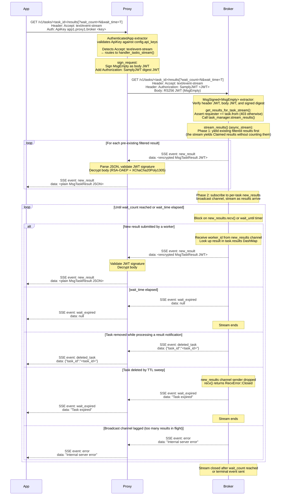

---

## 3. Socket Usage

Sockets require the `sockets` feature compiled into both proxy and broker. The initiating proxy embeds a freshly generated encryption key inside the end-to-end encrypted `MsgSocketRequest`; the receiving proxy extracts it after decryption. Both proxies then wrap their broker-side TCP connections in a streaming XChaCha20Poly1305 cipher with that key, so the broker relays ciphertext only.

### Socket Creation (Initiator Side)

```mermaid
sequenceDiagram
    participant App1
    participant Proxy1
    participant Broker
    participant Vault as Vault (PKI)

    App1->>Proxy1: POST /v1/sockets/app2.proxy2.broker<br/>Header: Upgrade: tcp<br/>Auth: ApiKey app1.proxy1.broker <key>

    note over Proxy1: AuthenticatedApp extractor<br/>validates ApiKey against config.api_keys

    note over Proxy1: create_socket_con():<br/>Generate random 32-byte SocketEncKey<br/>Encode as base64url string<br/>Store in task_secret_map (60s TTL)<br/>Build MsgSocketRequest with secret in body field

    loop for each recipient proxy (proxy2)
        Proxy1->>Broker: GET /v1/pki/certs (signed JWT)
        Broker-->>Proxy1: cached valid certificate serials
        Proxy1->>Broker: GET /v1/pki/certs/by_serial/<serial> (signed JWT)
        alt Broker cache miss
            note over Broker: CertificateCache synchronization:<br/>list serials, fetch CRL, invalidate revoked entries,<br/>fetch and validate all unseen certificates,<br/>retry requested-serial lookup
            Broker->>Vault: Certificate list, CRL, and unseen certificate PEMs
            Vault-->>Broker: PKI data
        end
        Broker-->>Proxy1: PEM certificate (502 if missing or invalid)
        note over Proxy1: Extract recipient RSA public key
    end

    note over Proxy1: Encrypt MsgSocketRequest body (SocketEncKey) for recipients<br/>Sign body JWT and Authorization: SamplyJWT digest JWT

    Proxy1->>Broker: POST /v1/sockets<br/>Header: Authorization: SamplyJWT <JWT><br/>Body: RS256 JWT (encrypted MsgSocketRequest)

    note over Broker: MsgSigned<MsgSocketRequest<Encrypted>> extractor:<br/>Verify header JWT, body JWT, and signed digest

    note over Broker: post_socket_request():<br/>Store in socket TaskManager DashMap<br/>Broadcast task ID on new_tasks channel<br/>Return Location: /v1/sockets/<task_id>

    Broker-->>Proxy1: 201 Created<br/>Location: /v1/sockets/<task_id>

    note over Proxy1: connect_socket():<br/>Retrieve SocketEncKey from task_secret_map<br/>Build GET /v1/sockets/<task_id><br/>  with Connection: upgrade, Upgrade: tcp<br/>Sign body JWT and Authorization: SamplyJWT digest JWT

    Proxy1->>Broker: GET /v1/sockets/<task_id><br/>Header: Upgrade: tcp<br/>Header: Authorization: SamplyJWT <JWT><br/>Body: RS256 JWT (MsgEmpty)

    note over Broker: connect_socket():<br/>Verify header JWT, body JWT, and signed digest<br/>Assert requester is task creator or recipient<br/>First side to connect: store OnUpgrade handle in<br/>waiting_connections map (60s TTL), await second side

    Broker-->>Proxy1: 101 Switching Protocols<br/>Header: Upgrade: tcp

    note over Proxy1: Upgrade HTTP connection to raw TCP socket<br/>Create EncryptedSocket wrapping Broker TCP socket:<br/>  XChaCha20Poly1305-LE31 streaming cipher<br/>  Exchange per-direction STREAM nonces with the peer proxy<br/>  through the broker byte relay

    Proxy1-->>App1: 101 Switching Protocols<br/>Header: Upgrade: tcp

    note over Proxy1: Spawn relay task:<br/>tokio::io::copy_bidirectional(<br/>  App1 TCP socket,<br/>  EncryptedSocket(Broker TCP socket)<br/>)
```

### Socket Retrieval (Receiver Side)

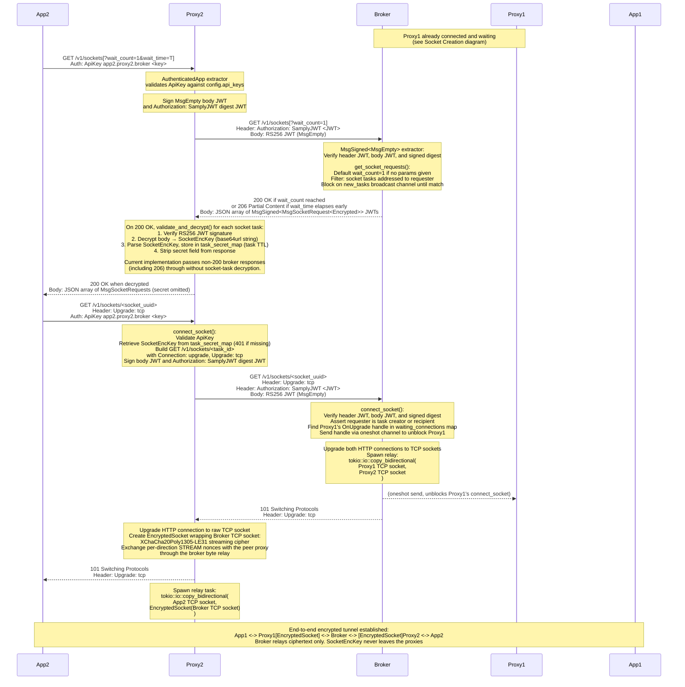

---

## 4. Background Processes

### Task and Result Expiry

Each `TaskManager` instance (one for tasks, one for sockets) runs a dedicated OS thread that sweeps for expired entries every five minutes. Listing reads and task-by-ID reads both go through `get_tasks_by`, which excludes expired tasks immediately, so callers never observe an expired entry there. Result retrieval by task ID starts from the stored task instead, so an expired task can still satisfy a result read until the sweep removes it. The sweep drops each expired task's storage and result broadcast channel, which terminates open SSE streams and long-poll waits on that task.

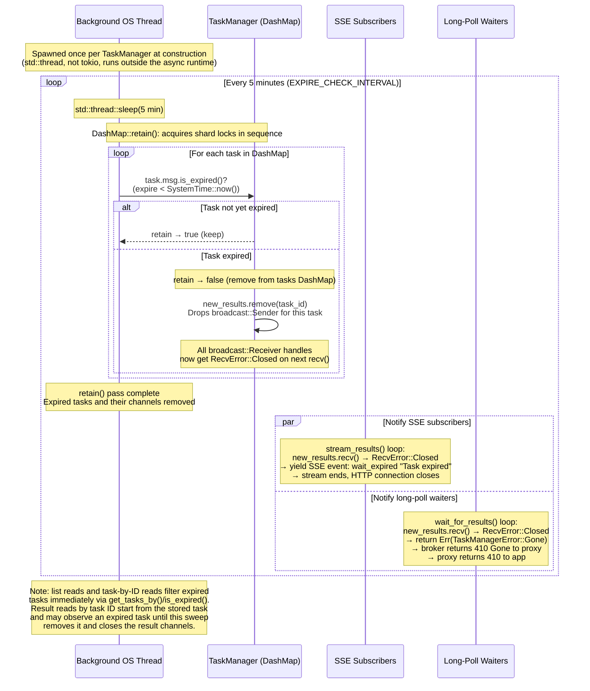

---

## 5. Health Monitoring

### Health Check Endpoints

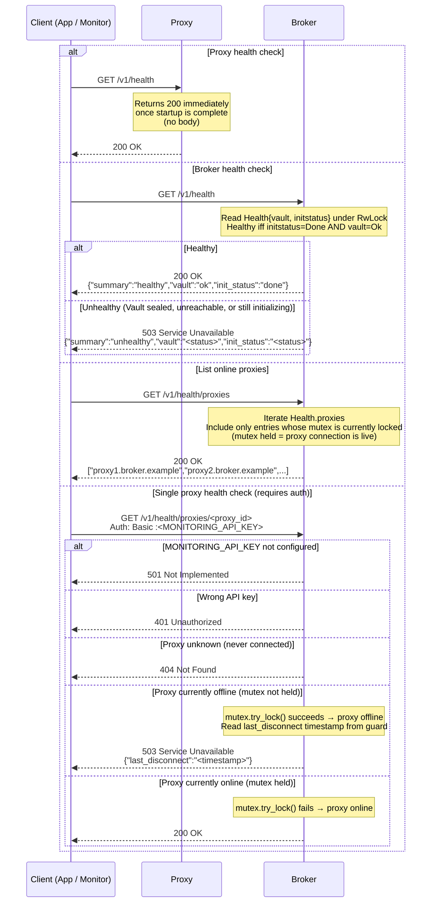
